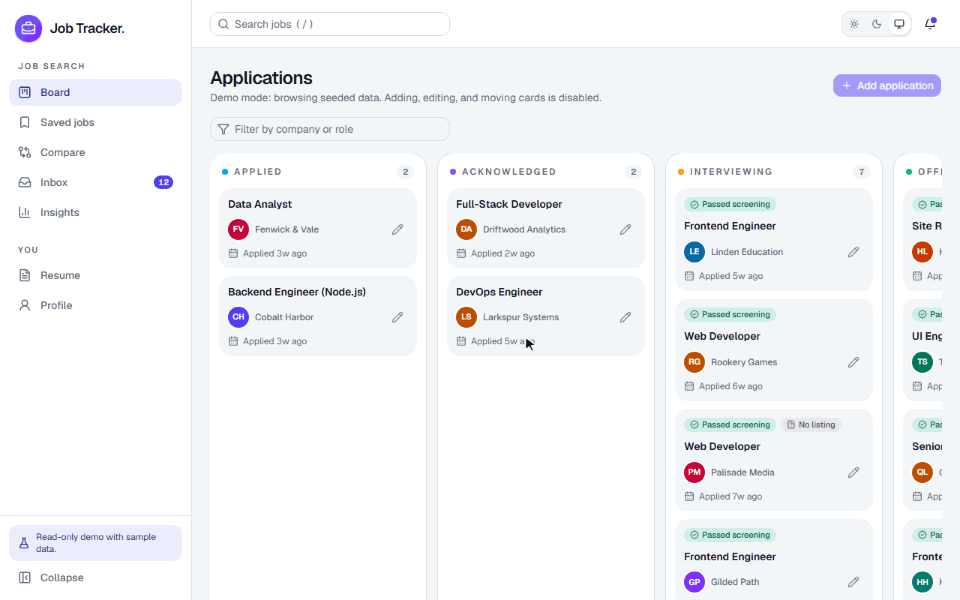
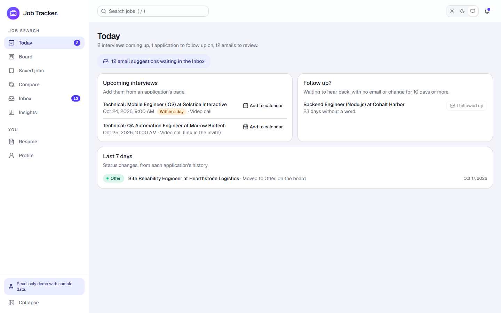
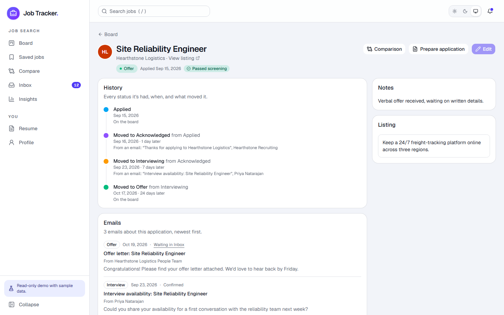
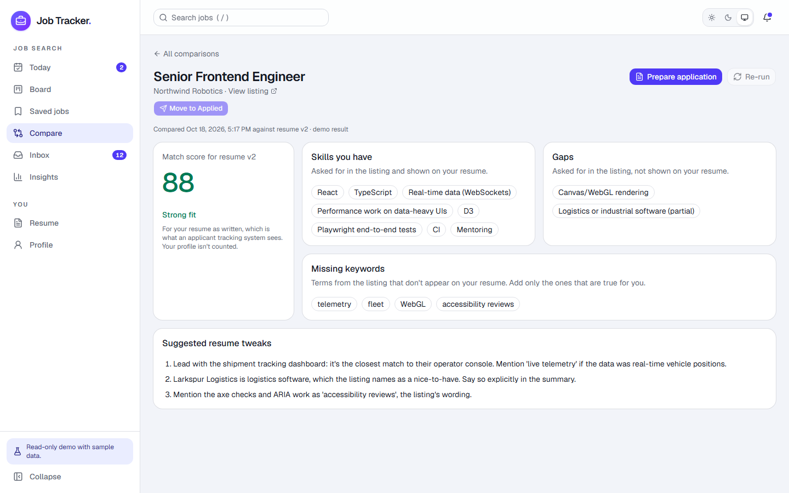
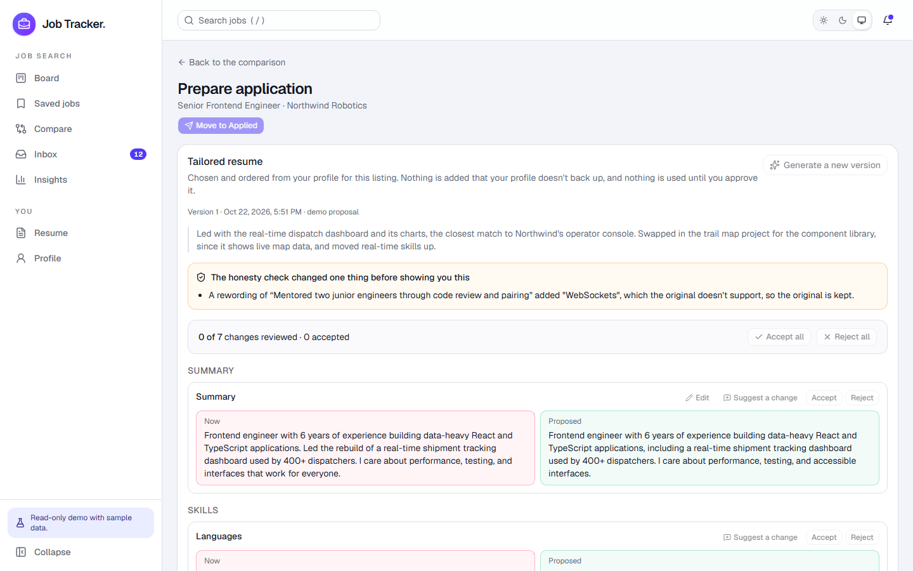
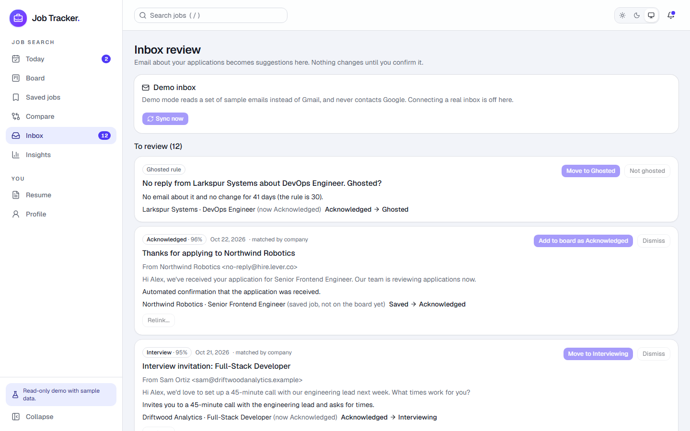
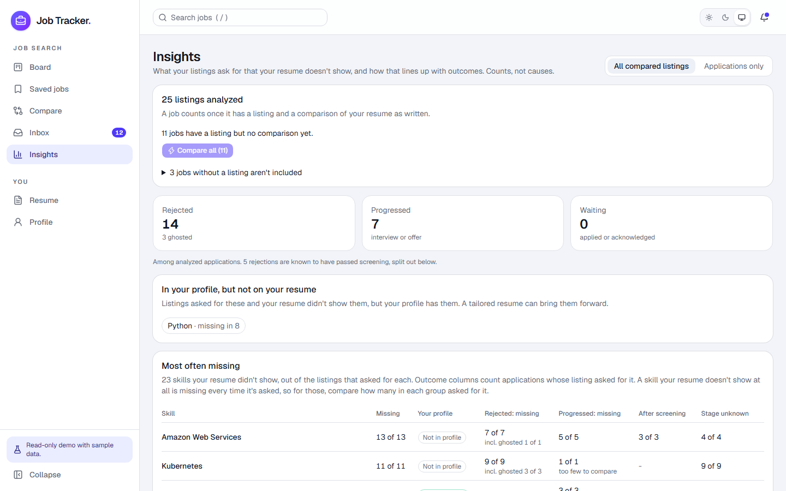
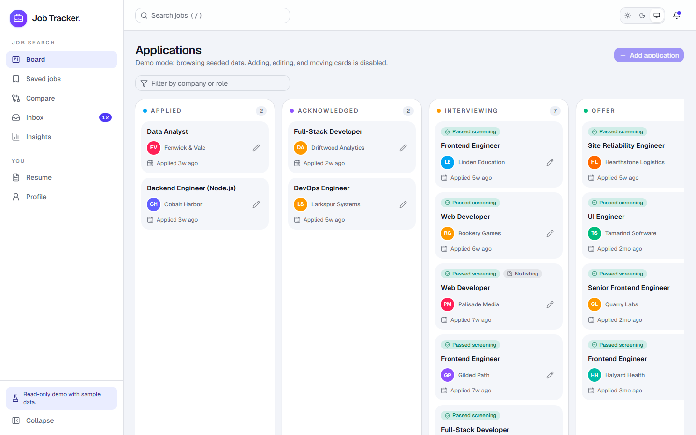
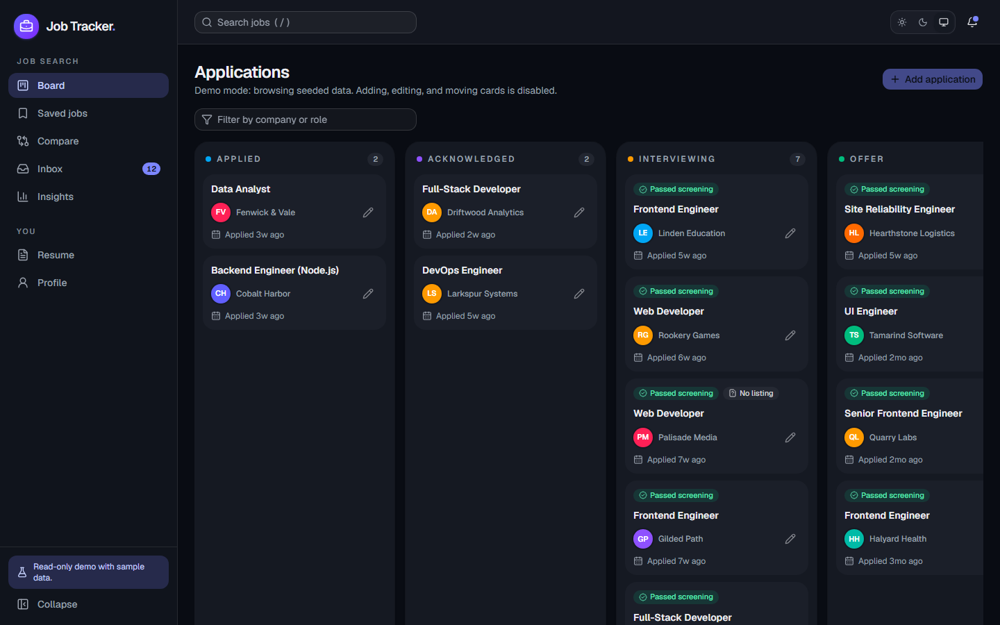
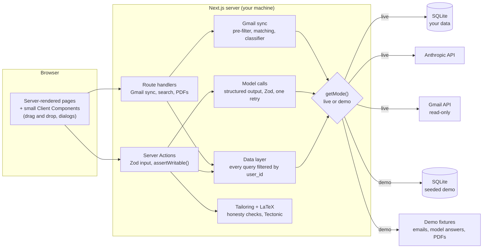

# Job Tracker

[](https://github.com/umrude/JobTracker/actions/workflows/ci.yml)

A job application tracker that does the tedious parts of a job search: it compares listings against your resume, tailors your resume and cover letter to a listing without inventing anything, and reads your Gmail to suggest status changes for you to confirm.

Built with Next.js (App Router), TypeScript, SQLite, and the Anthropic API. It runs on your own machine, so your resume and inbox stay local. A read-only demo with sample data runs with no accounts or API keys.

**[Try the live demo →](https://job-tracker-demo-f7ye.onrender.com/)** It's read-only, with a fake person, resume, and inbox. It's on a free host that sleeps when idle, so the first visit can take up to a minute.



## What it does

- **Today.** Where the app opens: upcoming interviews (with a calendar file for each), applications worth a follow-up after 10 quiet days, what's waiting in the Inbox, and the last week's changes.
- **Board.** Applications by status (Applied, Acknowledged, Interviewing, Offer, Rejected, Ghosted), with drag and drop, search, and a filter.
- **Application pages.** Each application's history: every status it's had, when, and what moved it (a drag, a confirmed email, the ghosted rule). Its page also lists the emails about it and its interviews, and links to its comparison and tailored resume.
- **Saved jobs.** Paste a listing to apply to later, then move it to the board when you apply.
- **Resume comparison.** Scores your resume against a listing and lists matched skills, gaps, and missing keywords. When a gap is something you do have, "I have this" adds it to your profile.
- **Tailored resumes.** The model picks, orders, and lightly rewords content from your profile for one listing. Code checks the result, you review every change, and the approved version is compiled from your LaTeX source to a one-page PDF.
- **Cover letters.** Written from the listing, the tailored resume, and your highlights, with tone and length options. You can edit them before sending.
- **Gmail sync.** Finds application emails (confirmations, interviews, rejections) and suggests status changes in a review inbox. Nothing on the board moves until you confirm it.
- **Insights.** How far your applications get (a funnel from applied to offer) and how long each step takes, which skills your listings ask for most often that your resume doesn't show, and how that lines up with outcomes. It reports counts, never causes.

| Today | Application page |
|---|---|
|  |  |
| **Comparison** | **Tailored resume review** |
|  |  |
| **Inbox review** | **Insights** |
|  |  |
| **Board** | **Dark mode** |
|  |  |

## Highlights

- **The model can't make things up on your resume, and code checks it.** "Don't invent anything" is in the prompt, but the prompt isn't relied on. Every skill must exist in your profile, bullets are referenced by ID, and a reworded bullet can't add a skill or a number its original didn't have. That last rule also keeps personal-project skills out of job bullets. Learning skills never appear on the resume. Anything that fails is reverted and shown to you (the yellow box in the screenshot above). Model text is escaped before it goes into LaTeX, and Tectonic compiles offline with risky TeX features turned off. ([docs/tailored-resumes.md](docs/tailored-resumes.md))
- **A demo mode that never calls an external service.** One function, `getMode()`, decides live or demo. Demo mode uses a seeded database with a fake person and resume, sample emails instead of Gmail, saved model answers instead of the Anthropic API, and pre-built PDFs. The public demo is read-only, enforced on the server by `assertWritable()` in every write, not just by disabling buttons.
- **Ready for more than one user.** Every table has an owner, every query filters by it, and the user id only ever comes from the session. A test file signs in as two users and checks that neither can see, change, or delete the other's data, one case per data-layer function. Sign-in is still limited to one email on purpose. ([docs/multi-user.md](docs/multi-user.md))
- **Gmail sync built to be cautious.** Read-only scope, incremental sync with Gmail's history API, a free keyword pre-filter before any model call, and matching that keeps near-identical roles at the same company apart. The refresh token is encrypted with AES-256-GCM, with a key kept outside the database. Email bodies are never stored. The classifier has a 40-case eval set. ([docs/gmail-sync.md](docs/gmail-sync.md))
- **Every model call returns validated data.** All calls go through one helper that asks for structured output, validates it with Zod, retries once, and then returns an error the UI can show. Results are saved, so reopening a page never re-runs the model.
- **Measured performance work.** With about 300 applications, the board and inbox were sending megabytes to the browser. The fix was to give Client Components only what they render. The board's navigation payload went from 1.4 MB to 70 KB, and the inbox page from 9.7 MB to 244 KB. ([docs/performance.md](docs/performance.md))
- **Accessible, and checked on every CI run.** axe-core tests every page against WCAG 2.1 AA in light, dark, and at phone size. The board can be used without a mouse: Space picks a card up, the arrow keys move it a column at a time, and the screen reader announces each move by name. There's also a skip link, real headings, and support for reduced motion. ([docs/accessibility.md](docs/accessibility.md))

## Architecture



- **Mutations are Server Actions and reads are Server Components.** Client Components exist only where interactivity needs them, and they get only what they render.
- **Server-only code lives in `src/server/`**, and every file there imports `server-only`, so it can't end up in the browser.
- **Zod schemas in `src/lib/schemas/` are the single source of truth for types.** Types are derived with `z.infer`, and the same schemas validate forms, Server Action input, and model output.
- **Pure logic is kept out of the I/O.** The email pre-filter, matching, status transitions, honesty checks, LaTeX scanning, and insights math are plain functions with their own tests.

```
src/
  app/
    (dashboard)/   today, board, applications, saved, compare, apply, inbox-review, insights, resume, profile
    api/           Gmail sync, OAuth callback, search, PDF and calendar routes
  server/          server-only: data layer, model calls, Gmail, LaTeX, getMode()
    db/            Drizzle schema, migrations, seed, isolation tests
  lib/             pure logic and Zod schemas, shared by server and client
docs/              design notes and decisions, one file per feature
scripts/           demo PDFs, classifier eval, performance, screenshots
```

## Decision log

The main choices and the reasons for them. Each doc has more detail.

| Decision | Why |
|---|---|
| **Runs locally, with a separate hosted demo** | Resumes and email are personal. The live app never needs to be public or always on. The demo has no real data and no way to reach any. |
| **SQLite with Drizzle** | One user's data fits easily in a single file. No database server to run, and Drizzle gives typed queries and migrations. |
| **Every table has its own `user_id`, child tables included** | One rule with no exceptions ("every query filters by user_id") beats "filter, or join to a parent that does". The `NOT NULL` column makes the type checker flag an insert that forgets the owner. ([multi-user](docs/multi-user.md)) |
| **Sync suggests, you confirm** | A classifier will sometimes be wrong. A wrong suggestion costs one click. A wrongly moved application could go unnoticed. ([Gmail sync](docs/gmail-sync.md)) |
| **A keyword pre-filter before the model** | Most email isn't about job applications. Known applicant-tracking senders and subject patterns weed it out for free, so the model only sees likely candidates. |
| **A cheaper, faster model for email, a stronger one for writing** | Classification is short and runs many times per sync. Comparisons and tailoring run once per job and need judgment. The classifier's eval set measures any model change. |
| **Honesty checks in code, not just the prompt** | A prompt is a request, not a guarantee. The checks catch made-up skills and numbers mechanically, and your review catches the subtle cases. ([tailored resumes](docs/tailored-resumes.md)) |
| **Your own edits are flagged, not reverted** | Text you write is yours, but it's flagged when your profile doesn't back it, with a one-click "add it to your profile". |
| **Profile owns content, LaTeX owns layout** | Tailoring edits the content and keeps your .tex's design, so the PDF still looks like your resume. |
| **Tectonic for PDFs** | A single binary that can run offline with risky TeX features turned off. The public demo has no TeX engine and serves pre-built PDFs. |
| **Store the text, never the uploaded file** | Resumes are parsed to text on upload. Email bodies are read from Gmail when needed and never stored. Less personal data sitting on disk. |
| **Comparisons score the resume as written** | That's what an applicant tracking system sees. Your profile and tailored versions are shown separately, with a note that the tailored one was written toward the listing. |
| **Insights shows counts, not causes** | With a few dozen applications, any "this skill got you rejected" claim would be noise. Small samples are labeled "too few to compare". ([insights](docs/insights.md)) |
| **Interviews are entered by hand, with calendar files** | Most interview emails ask for availability rather than naming a time, so reading dates out of them would be unreliable and cost more model calls. An `.ics` download works with any calendar, with no extra Google permissions. ([today](docs/today.md)) |
| **Search is a GET route, not a Server Action** | Server Actions run one at a time, so a search per keystroke would queue up. A GET route can run in parallel and be cancelled. ([search](docs/search.md)) |
| **Client Components get only what they render** | Everything passed to a Client Component is sent to the browser. Lists send summaries, and details load when a dialog opens. ([performance](docs/performance.md)) |

## Running it

Requires pnpm and a patched Node.js: 22.23.4+, 24.22.1+, or 26.12.1+ (the October 2026 security releases). CI and the hosted demo are pinned to 22.23.4.

### Demo mode (no accounts, keys, or `.env`)

```bash
pnpm install
DEMO_MODE=true pnpm dev      # PowerShell: $env:DEMO_MODE="true"; pnpm dev
```

Open http://localhost:3000. The demo is read-only, with a fake person, resume, and inbox. The server builds the demo database from the seed each time it starts.

### Live mode

Copy `.env.example` to `.env`, then:

1. **Google sign-in.** Create an OAuth client in Google Cloud Console, then set `GOOGLE_CLIENT_ID`, `GOOGLE_CLIENT_SECRET`, `ALLOWED_EMAIL` (the only account allowed to sign in), and `AUTH_SECRET` (generate one with `npx auth secret`). The redirect URIs to register are listed in `.env.example`.
2. **Anthropic API key.** Set `ANTHROPIC_API_KEY` for comparisons, tailoring, cover letters, and email classification.
3. **Gmail (optional).** Enable the Gmail API, add the `gmail.readonly` scope, and set `TOKEN_ENCRYPTION_KEY`. Step by step: [docs/gmail-sync.md](docs/gmail-sync.md).
4. **Tectonic (optional).** Install [Tectonic](https://tectonic-typesetting.github.io/) for tailored resume PDFs, and compile your resume once from a terminal to download its packages.
5. **Start it.** Run `pnpm db:migrate`, then `pnpm build && pnpm start`.

In live mode, "Preview demo mode" in the sidebar switches to a writable copy of the demo data, reset on every restart.

### Hosted demo

The public demo is the same app with `DEMO_MODE=true`, deployed separately from the live app. It needs no secrets: there's no sign-in, no Anthropic key, and no Gmail. It has no disk either, since the server rebuilds the demo database from the seed when it starts.

- **On Render:** [render.yaml](render.yaml) is a Blueprint for a free web service. In the Render dashboard, choose New > Blueprint and pick this repository. It redeploys on every push to main.
- **On any other Node host:** set `DEMO_MODE=true`, then use these commands:
  - build: `corepack enable && pnpm install --frozen-lockfile --prod=false && pnpm build`
  - start: `pnpm start`

What keeps it safe to leave public:
- **Writes are refused on the server**, not just disabled in the UI.
- **Nothing on the host can reach real data**, and the demo never calls an external service.
- **The auth routes return 404.**
- **Every response gets basic security headers:** no framing, no MIME sniffing, and a strict referrer policy.

**Visit counts:** the hosted demo counts visits with [GoatCounter](https://www.goatcounter.com/), set by `GOATCOUNTER_URL` in `render.yaml`. It records pages, referrers, and rough location, with no cookies and nothing personal. It runs in the visitor's browser, so the demo server itself still makes no outside calls. Only the public demo loads it: the live app, local development, and CI never do, even with the variable set.

CI runs the end-to-end tests against this exact build. To check the deployed demo itself, point the same tests at it: `E2E_BASE_URL=https://job-tracker-demo-f7ye.onrender.com pnpm test:e2e`.

### Commands

| Command | What it does |
|---|---|
| `pnpm dev` | Development server |
| `pnpm build` / `pnpm start` | Production build and server |
| `pnpm typecheck` / `pnpm lint` / `pnpm test` | Type check, lint, unit tests |
| `pnpm test:e2e` | End-to-end tests against the demo (starts its own server on port 3100) |
| `pnpm db:migrate` / `pnpm db:seed` | Apply migrations / rebuild the demo database (the server also does this when it starts) |
| `pnpm db:backfill-history` | Once, after upgrading to status history: reconstructs it for older applications ([status history](docs/status-history.md)) |
| `pnpm demo:pdfs` | Rebuild the demo's pre-built PDFs (needs Tectonic) |
| `pnpm eval:classifier` | Run the email classifier on its eval set (real API calls, a few cents) |
| `pnpm perf:seed` / `pnpm perf:measure` | Build a large database and time each page ([performance](docs/performance.md)) |
| `pnpm screenshots` | Retake this README's screenshots from a running demo |
| `pnpm demo:gif` | Re-record this README's demo GIF from a running demo |

## Testing

About 550 unit tests run with Vitest, and none of them call the real Anthropic API or Gmail. They cover:

- **Pure logic, tested directly:** the email pre-filter and matching, status transitions, honesty checks, the LaTeX scanner, search ranking, and insights.
- **Model functions:** run against a mocked client, including malformed output, the single retry, and the error that follows.
- **Data isolation:** `src/server/db/isolation.test.ts` runs two users against a real SQLite database, with a case for every data-layer function.
- **Migrations:** checked for the foreign-key rules Drizzle doesn't generate.
- **Real Tectonic:** one test compiles the demo resume with the real compiler when Tectonic is on your PATH, and is skipped otherwise.

**End-to-end tests** (Playwright, in `e2e/`) drive the demo in a real browser. They cover the board and its filter, read-only mode (including the server refusing a write, and the auth routes returning 404), pre-built PDFs, search, a comparison leading to a tailored resume and its honesty check, the inbox, insights, and the theme and sidebar being remembered across reloads. An accessibility suite runs axe on every page in light, dark, and at phone size, checks that no page scrolls sideways on a phone, and checks the skip link.

**CI** (GitHub Actions) runs on every push and pull request with no real secrets. One job runs the type check, lint, and unit tests. The other seeds the demo, makes a production build, and runs the end-to-end tests against it. On failure, the Playwright report is uploaded as an artifact.

## Docs

| Doc | Covers |
|---|---|
| [tailored-resumes.md](docs/tailored-resumes.md) | Profile, skill aliases, comparison gaps, tailoring, honesty checks, LaTeX and PDFs |
| [cover-letters.md](docs/cover-letters.md) | Cover letter options, versions, and honesty warnings |
| [gmail-sync.md](docs/gmail-sync.md) | OAuth, token storage, sync, pre-filter, matching, classifier and its eval |
| [status-history.md](docs/status-history.md) | Every status change and when, how older applications are reconstructed, and the application page |
| [today.md](docs/today.md) | Today: follow-up nudges, interviews and calendar files, the week's activity |
| [insights.md](docs/insights.md) | What's counted, outcome groups, small samples |
| [multi-user.md](docs/multi-user.md) | Ownership design and what opening sign-up would take |
| [search.md](docs/search.md) | Ranking and snippets |
| [performance.md](docs/performance.md) | What was slow, what changed, and measurements |
| [design.md](docs/design.md) | Colors, dark mode, layout |
| [accessibility.md](docs/accessibility.md) | WCAG checks, keyboard dragging, mobile fixes, and known gaps |
